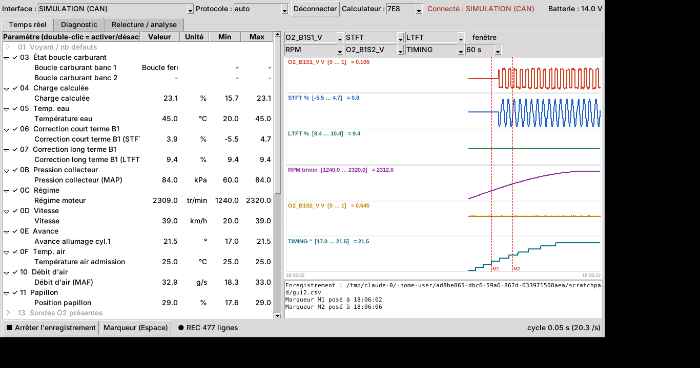

# obdeeepc : diagnostic et enregistreur OBD-II générique

Un seul fichier Python (`obdeeepc.py`), sans bibliothèque à installer. Il fonctionne avec une interface J2534 (Tactrix OpenPort 2.0 ou autre) et sait lire **n'importe quel véhicule compatible OBD-II / EOBD** : essence en Europe depuis 2001, diesel depuis 2004, et la plupart des véhicules US depuis 1996.



## Ce qu'il sait faire

**Protocoles, détectés automatiquement :**
- CAN ISO 15765-4 (11 ou 29 bits, 500 ou 250 kbit/s), sur la plupart des véhicules depuis 2005-2008 ;
- KWP2000 ISO 14230-4 et ISO 9141-2, sur la ligne K (comme ta 807) ;
- SAE J1850 VPW et PWM (anciens véhicules américains).

**Onglet Temps réel :**
- **Paramètres :** tous les paramètres standard que le calculateur déclare gérer. Ça comprend le régime, la charge, les températures, les corrections de richesse, la MAP/MAF et l'avance. S'y ajoutent les sondes O2 (bande étroite et large bande, jusqu'à 8), la température du catalyseur, l'EGR, la pression de rampe, l'huile, la consommation, le couple, etc. Un double-clic active ou désactive un paramètre.
- **Courbes :** jusqu'à 6 courbes empilées, chacune avec sa propre échelle, sur une fenêtre de 30 s à 10 min.
- **Choix du calculateur :** sur les véhicules où plusieurs répondent (moteur, boîte…).
- **Enregistrement CSV et marqueurs :** le CSV est au format Excel français, et la barre Espace pose un marqueur. À l'arrêt de l'enregistrement, un **résumé d'analyse** `_resume.txt` est écrit automatiquement à côté du CSV.

**Onglet Diagnostic :**
- **Codes défaut :** confirmés (03), en attente (07) et permanents (0A), pour tous les calculateurs.
- **Freeze frame (02) :** l'état du moteur au moment où le défaut s'est déclenché.
- **Préparation OBD (01) :** le voyant et les moniteurs terminés ou non, utile avant un contrôle technique. Avec, le VIN et la référence de calibration (09).
- **Tests sondes O2 (05) :** seuils et temps de bascule mesurés par le calculateur (hors CAN uniquement).
- **Autotests (06) :** résultats des tests internes (sondes, catalyseur, EGR, ratés d'allumage…) avec leurs limites et un verdict OK ou HORS LIMITES.
- **Effacement des codes (04) :** avec une confirmation, car il remet aussi les moniteurs à zéro.
- **Rapport :** il s'enregistre en .txt.

**Onglet Relecture / analyse :** ouvre un CSV déjà enregistré, affiche 6 courbes avec les marqueurs, permet de se déplacer dans le temps et produit le résumé d'analyse.

Le résumé d'analyse contient :
- les valeurs min, moyenne et max ;
- le temps passé en boucle fermée ou ouverte ;
- les bascules des sondes O2 ;
- les corrections de richesse et l'avance par plage de régime ;
- ce qui se passait autour de chaque marqueur ;
- une liste de points d'attention : LTFT au-delà de ±10 %, sonde amont paresseuse ou déséquilibrée, sonde aval qui recopie l'amont (catalyseur), corrections en butée, moteur qui ne chauffe pas…

**Analyse par Gemini (internet nécessaire) :**
- **Onglet Relecture → « ✦ Analyser avec Gemini » :** envoie à Gemini le résumé d'analyse, un extrait réduit du CSV (environ 300 lignes, plus toutes les mesures à ±5 s autour de chaque marqueur) et le rapport de l'onglet Diagnostic s'il y en a un. Une petite fenêtre permet d'ajouter tes symptômes ou ta question. La réponse s'affiche et s'enregistre dans `<nom du csv>_gemini.txt`.
- **Onglet Diagnostic → « ✦ Expliquer avec Gemini » :** explique les codes défaut, la freeze frame, les moniteurs et les autotests, puis donne les contrôles à faire.
- **« Réglages Gemini… » :** la clé API (Google AI Studio), le modèle (bouton « Charger la liste ») et une description du véhicule, envoyée à chaque analyse. Tout est rangé dans `C:\Diag\obdeeepc_config.json`, sur le PC uniquement : **ne partage pas ce fichier**, il contient ta clé. Le VIN n'est jamais envoyé.
- **En ligne de commande :** `py obdeeepc.py --gemini essai.csv`

## Installation sur l'eeePC (une seule fois, sans Python)

1. Télécharger [`installer_obdeeepc.bat`](https://github.com/kiki32600/eeepc/raw/main/installer_obdeeepc.bat) (clic droit, « Enregistrer sous »), puis double-cliquer dessus.
2. Il télécharge la dernière version compilée, l'installe dans `C:\Diag\obdeeepc` et crée l'icône **obdeeepc** sur le Bureau.
3. **Fermer FORScan / Diagbox** avant d'utiliser l'outil : une seule application à la fois peut utiliser l'interface.

**Où sont les fichiers :**
| Quoi | Où |
|---|---|
| Programme | `C:\Diag\obdeeepc\` (remplacé à chaque mise à jour) |
| Réglages, dont la clé Gemini | `C:\Diag\obdeeepc_config.json` (jamais publié, jamais écrasé) |
| Enregistrements CSV, résumés, journal | `C:\Diag\Logs_Input\` |

**Mises à jour :** au démarrage, s'il y a internet, l'outil regarde sur GitHub si une version plus récente existe et propose de l'installer. Il se ferme, remplace ses fichiers et se relance. Sans internet, il démarre normalement. Les réglages et les enregistrements ne sont pas touchés.

**Test sans voiture :** `C:\Diag\obdeeepc\obdeeepc.exe --sim` affiche deux interfaces « SIMULATION (ligne K) » et « SIMULATION (CAN) ».

**Mode script (facultatif) :** avec Python 3 32 bits, `py obdeeepc.py` fonctionne aussi. Dans ce mode, la mise à jour remplace `obdeeepc.py`.

## Utilisation

1. Brancher l'interface, puis mettre le **contact** (moteur tournant pour les mesures).
2. Lancer l'icône **obdeeepc**, choisir l'interface, puis cliquer sur **Connecter**.
   - **Choix du protocole :**
     - `auto` essaie le CAN puis la ligne K, puis le J1850.
     - `auto_kline` (conseillé pour ta 807) et `auto_can` vont plus vite.
     - On peut aussi choisir un protocole précis.
   - **Mémorisation :** le choix d'interface, de protocole et de paramètres est retenu dans `C:\Diag\obdeeepc_config.json`.
   - **Reconnexion :** l'outil essaie d'abord le protocole qui a marché la dernière fois. Sur la ligne K, il fait 3 tentatives par protocole, avec une pause de 1 s puis de 5,5 s : un calculateur garde l'ancienne session ouverte environ 5 s. À la déconnexion, la session est fermée proprement.
   - **Journal :** tout ce qui s'affiche dans le cadre sous les courbes est aussi écrit dans `obdeeepc_journal.txt`, dans le dossier des enregistrements.
   - **Journal détaillé** (case à cocher avant Connecter) : enregistre toutes les trames échangées dans `obdeeepc_trames_….txt`. À activer et à m'envoyer en cas de souci de connexion ou de lecture.
   - **Paramètres muets :** un paramètre annoncé par le calculateur mais qui ne répond pas 3 fois de suite est retiré de la lecture et marqué « (muet) ». Le bas de la fenêtre affiche le temps moyen par paramètre.
3. Les enregistrements vont par défaut dans `C:\Diag\Logs_Input`.

En ligne de commande :
```
py obdeeepc.py --cli --proto auto_kline --csv essai.csv --pids 03,06,07,0C,14,15
py obdeeepc.py --cli --diag            (lit aussi codes, freeze frame, préparation, autotests)
py obdeeepc.py --analyse essai.csv     (résumé d'un enregistrement existant)
```

### Vitesse d'acquisition

| Protocole | Vitesse typique |
|---|---|
| CAN | 6 paramètres par requête, environ 15 à 20 cycles/s pour une vingtaine de paramètres |
| Ligne K / J1850 | 1 paramètre par requête, ~80 ms chacun : environ 1 cycle/s avec 12 paramètres, 4 à 5 cycles/s avec 3 paramètres |

Sur la ligne K, désactivez ce qui ne sert pas. Pour la régulation lambda, gardez 03, 06, 07, 0C et 14.

## Lire les sondes lambda (essence, sonde bande étroite)

| Paramètre | Normal (moteur chaud) | Suspect |
|---|---|---|
| Boucle carburant (03) | `BF` en stabilisé ; `BO_charge` en pleine charge ou au lever de pied | Repasse souvent en `BO_*`, ou `BO_defaut` / `BF_defaut` |
| Sonde amont B1S1 | Oscille entre ~0,1 et ~0,8-0,9 V | Lente, bloquée vers 0,45 V, ne dépasse pas 0,7 V ou ne descend pas sous 0,2 V |
| Sonde aval B1S2 | Stable vers 0,6-0,7 V | Recopie les oscillations de l'amont (catalyseur fatigué) |
| STFT (06) | Autour de 0, à ±10 % | Collée à une butée (±25 %) |
| LTFT (07) | Entre -10 et +10 % | Au-delà de ±10 % : prise d'air, pression d'essence, injecteurs, sonde |
| Avance (0E) | À comparer 95 / 98 à régime et charge identiques | Chute en charge : cliquetis détecté |

## OpenVehicleDiag : pourquoi il ne voit pas le câble

OVD ne cherche les interfaces J2534 que dans `HKLM\SOFTWARE\WOW6432Node\PassThruSupport.04.04`, une clé qui n'existe que sur un Windows 64 bits. Ton eeePC (Atom Z520) tourne forcément sous Windows 32 bits. `ovd_fix_registre.ps1`, lancé en administrateur, copie la déclaration de l'OpenPort au bon endroit sans toucher à l'original.

## Ce qui est sûr et ce qui ne l'est pas

- **Testé :** tout fonctionne de bout en bout avec les deux simulations (ligne K et CAN) : affichage, courbes, CSV, marqueurs, résumé, relecture et tous les services de diagnostic. Les décodages suivent la norme SAE J1979. L'envoi à Gemini a été testé contre un faux serveur qui imite l'API Google, pas encore avec ta vraie clé.
- **Pas encore testé sur un vrai véhicule ni avec un vrai OpenPort.** Si une connexion échoue, envoie-moi le journal (cadre sous les courbes, aussi dans `C:\Diag\Logs_Input\obdeeepc_journal.txt`).
- **Détection CAN :** en mode `auto`, le CAN est essayé avant la ligne K. Sur un véhicule CAN à 250 kbit/s (rare en voiture, fréquent en poids lourd), l'essai à 500 kbit/s peut provoquer brièvement des erreurs sur le bus. C'est la méthode habituelle des outils de diagnostic, mais choisir le protocole évite cet essai.
- **Mode 06 :** les échelles viennent de la table SAE (UAS) pour le CAN. Sur la ligne K, les valeurs sont brutes car l'échelle dépend du constructeur ; le verdict OK / HORS LIMITES reste valable.
- **Hors OBD :** seul l'OBD standard est couvert. Les paramètres propres à un constructeur (adaptations PSA, injecteurs, cliquetis par cylindre…) ne sont pas lisibles par ce biais.

## Publier une nouvelle version (mainteneur)

1. Modifier `obdeeepc.py` et augmenter `VERSION` (par exemple `2.3.1`).
2. Pousser sur `main`.
3. Le workflow « Compilation et publication » teste l'outil en simulation et compile l'exe 32 bits sous Windows avec PyInstaller. Si la Release `v<VERSION>` n'existe pas encore, il la crée, tag compris, avec `obdeeepc-win32.zip` et `obdeeepc.py`. Les eeePC la proposent au démarrage suivant. Un push sans changement de `VERSION` ne fait qu'une compilation de contrôle.
